# Release report, evidence package, technical defense, and AI Disclosure

## 1. Published site
  - Published site (live):
    - Live URL: https://nicomorente15.github.io/rootedtogether/ 
    - deployed to GitHub Pages (repository: https://github.com/nicomorente15/rootedtogether)

## 2. Repository
Repository root: [Production Website Capstone_Morente](Production Website Capstone_Morente)
Remote repository: https://github.com/nicomorente15/rootedtogether

Final state (meaningful final state and README/release notes):
- Pages (production-ready):
  - [index.html](index.html)
  - [about.html](about.html)
  - [contact.html](contact.html)
  - [events.html](events.html)
  - [get-involved.html](get-involved.html)
  - [resources.html](resources.html)
- Assets and styles (inventory):
  - Stylesheet:
    - [css/styles.css](css/styles.css)

  - Images:
    - [Images/Hero-1200.jpg](Images/Hero-1200.jpg)
    - [Images/Hero-800.jpg](Images/Hero-800.jpg)
    - [Images/Hero-400.jpg](Images/Hero-400.jpg)
    - [Images/birdHouse-1200.jpg](Images/birdHouse-1200.jpg)
    - [Images/birdHouse-800.jpg](Images/birdHouse-800.jpg)
    - [Images/birdHouse-400.jpg](Images/birdHouse-400.jpg)
    - [Images/cactusPots-1200.jpg](Images/cactusPots-1200.jpg)
    - [Images/cactusPots-800.jpg](Images/cactusPots-800.jpg)
    - [Images/cactusPots-400.jpg](Images/cactusPots-400.jpg)
    - [Images/Logo.svg](Images/Logo.svg)

  - Pages (HTML):
    - [index.html](index.html)
    - [about.html](about.html)
    - [contact.html](contact.html)
    - [events.html](events.html)
    - [get-involved.html](get-involved.html)
    - [resources.html](resources.html)

  - Documentation and evidence:
    - [README.md](README.md)
    - [PlanningEvidence/](PlanningEvidence/) 
    - [BuildEvidence/](BuildEvidence/)
    - [Screenshots/](Screenshots/)
    - [Images/](Images/)

## 3. Production website
Scope delivered:
  - Single-page templates for main sections of the site: Home, About, Events, Get Involved, Resources, Contact.
  - Static content only. No JavaScript content, navigation, or reading.

Semantic HTML and modern CSS:
  - All pages use semantic elements (header, nav, main, article/section, footer, h1, h2, h3, p, ul/ol, form controls with labels).
  - Responsive images are provided and referenced from the Images/ folder using srcset/sizes.
  - CSS follows a component-driven structure (see Build evidence below). The site degrades gracefully if styles are not available.

## 4. Planning evidence
- Planning package (detailed brief, content inventory, sitemap, behavior annotations, and responsive wireframes): [PlanningEvidence/planning%20package_Morente.pdf](PlanningEvidence/planning%20package_Morente.pdf).

- Acceptance criteria (workshop notes and final acceptance checklist): [PlanningEvidence/acceptance%20criteria_Morente.pdf](PlanningEvidence/acceptance%20criteria_Morente.pdf)

- Responsive wireframes (wide / medium / narrow layouts): 

Content architecture 
- Primary navigation: Home, About, Events, Get Involved, Garden Resources, Contact
- Page-level priorities:
  - Home: Hero, mission, featured events, CTA, large garden imagery
  - About: Mission, history, gallery-style images and descriptive copy
  - Events: Event cards (image, date, title, description, location)
  - Get Involved: Volunteer instructions and contact CTA
  - Garden Resources: Tips, links, and downloadable resources
  - Contact: Contact details and well-labeled form

Responsive wireframes:
  - Wireframe artifacts: wide / medium / narrow wireframes (linked above). These show how the page content reflows from a multi-column desktop layout to stacked single-column mobile layouts.
  - Wide (desktop): multi-column hero with side-by-side content blocks and a 3+ column event card layout.
  - Medium (tablet): condensed header, centered hero, two-column event group where space allows, larger touch targets for CTAs.
  - Narrow (mobile): stacked flow, image-first presentation for hero and split sections so visuals remain prominent and readable; event cards collapse to a single column and CTAs stack vertically.
  - Behavior annotations (from the planning package): navigation visibility rules, image alt-text guidance, form labeling and validation behavior, card structure, and footer stacking.

Acceptance criteria
- Responsive layout
  - When viewed at mobile widths (320px, 375px, 425px up to 767px), navigation, content sections, images, and buttons must fit the viewport without horizontal scrolling. Verification: manual checks using browser DevTools at 320 / 375 / 425 / 768 px and attached screenshots (see Release Evidence screenshots).
  - At tablet/desktop widths (768px, 1024px, 1440px), the site rearranges into multi-column layouts while maintaining readable spacing and hierarchy. Verification: DevTools snapshots at 768 / 1024 / 1440 px.

- Accessibility
  - All interactive controls (links, buttons, form fields) are reachable and operable using keyboard only (Tab, Shift+Tab, Enter, Space). Verification: manual keyboard walkthrough and focus indicator screenshots attached.
  - Informative images include descriptive alt text; decorative images use empty alt attributes. Verification: inspection of HTML and screen reader sampling recorded in the accessibility evidence.

- Browser support
  - Site functions in current versions of Chrome, Firefox, Safari, and Edge with graceful fallbacks for unsupported CSS features. Verification: cross-browser snapshots including the provided Safari screenshot.

- Performance
  - Essential content must be accessible quickly while large images may load progressively. Verification: Lighthouse checks (see Release Evidence: Performance diagnostics) — pages meet the acceptance thresholds documented in the acceptance criteria PDF.

- Metadata & discoverability
  - Each page contains a unique title, meta description, and appropriate heading structure. Verification: metadata inventory and discoverability evidence in BuildEvidence.

## 5. Build evidence (Modules 2–6 items)
CSS architecture
  - File: [BuildEvidence/CSS architecture_Morente.md](BuildEvidence/CSS architecture_Morente.md)
  - Summary: Refactored the stylesheet into tokens, reset, base, components and utilities. Reduced duplication and lowered specificity by moving repeated values into CSS custom properties (colors, spacing, radii, focus styles). Naming conventions and ordering (tokens > reset > components > utilities > responsive) are documented. 
  - Why it matters: Provides the source of truth for design tokens and component rules used across pages and documents the rationale for responsive stacking and focus styles.

Responsive layout
  - File: [BuildEvidence/responsive layout_Morente.md](BuildEvidence/responsive layout_Morente.md)
  - Summary: Documented the responsive layout foundation and progressive enhancements: content-driven breakpoints, intrinsic grid patterns (auto-fit + minmax), container-query preparedness (with fallbacks), clamp() spacing, and prefers-reduced-motion support. Includes test notes for narrow/medium/wide layouts, 200% zoom, keyboard focus, and fallback checks.
  - Evidence & tests: Manual checks at 360–480px (mobile stacking), 768–1024px (tablet two-column), >1100px (desktop layout), and 200% zoom. Notes on feature detection and progressive enhancement are included.

Media & typography
  - File: [BuildEvidence/media:typography_Morente.md](BuildEvidence/media:typography_Morente.md)
  - Summary: Responsive image testing (picture + srcset) at the key viewports (320, 375, 768, 1024, 1440). Verified CLS avoidance via intrinsic sizing / aspect-ratio, measured CLS (0.02), tested font and zoom behavior (200%), and slow-network image fallback behavior. Confirms use of system fonts and fallback strategies; documents image filenames used on the site.
  - Evidence & tests: 3G/Slow emulation, zoom checks, Lighthouse CLS measurements, and confirmation that srcset selects appropriate images for each breakpoint.

Accessibility
  - File: [BuildEvidence/accessibility_Morente.md](BuildEvidence/accessibility_Morente.md)
  - Summary: Comprehensive accessibility testing notes including axe DevTools scans, keyboard and focus walkthroughs, zoom/reflow checks, VoiceOver sampling, and remediation log. The document records the pages tested (index, about, contact), evidence screenshots, and a remediation log of fixes (skip link, alt text fixes, focus styles, form labels).
  - Evidence & tests: axe DevTools scans (no violations for tested pages), keyboard focus screenshots, 200% zoom screenshot, VoiceOver recording of contact form interactions, and guidance for WCAG checks.

Discoverability (metadata & structured data)
  - File: [BuildEvidence/discoverability evidence_Morente.md](BuildEvidence/discoverability evidence_Morente.md)
  - Summary: Metadata inventory for all pages (title, meta description, canonical recommendations), social metadata (Open Graph examples), structured data JSON‑LD examples for site and events, image discoverability guidance, and decision notes about robots/sitemap. Includes a validated events JSON‑LD example.
  - Evidence & tests: Metadata inventory, sample JSON‑LD, and notes on validation and search-engine considerations.

## 6. Release evidence
1. Validation
 HTML validation
   - Method: Html Checker (vnu) via https://validator.w3.org
   - Summary: All HTML pages validated with no errors or warnings.
   - Results per page (screenshots):
     - index.html - No errors or warnings. 
     - about.html - No errors or warnings. 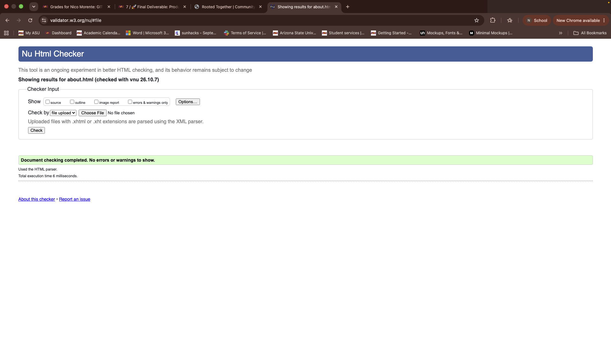
     - contact.html - No errors or warnings. 
     - events.html - No errors or warnings. 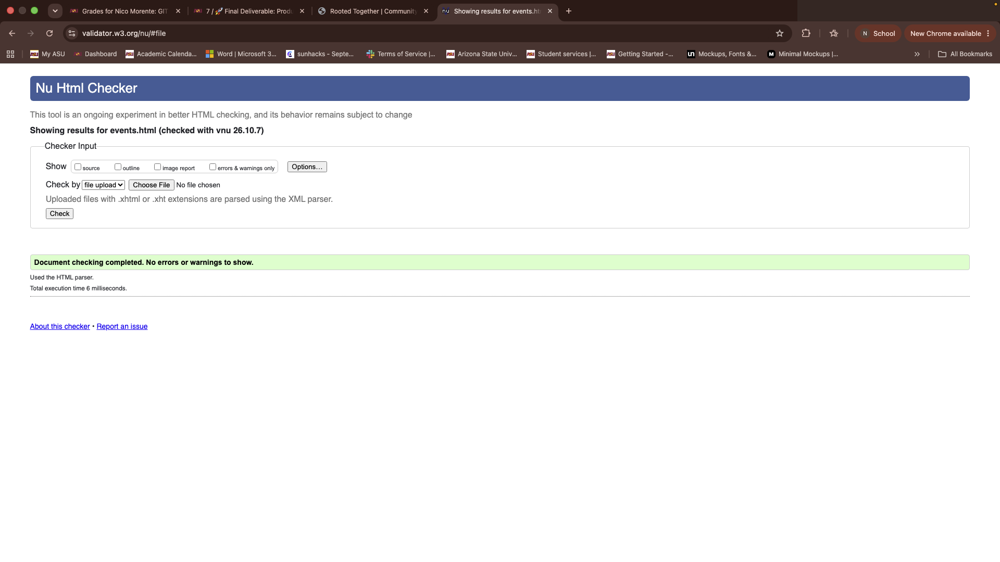
     - get-involved.html - No errors or warnings.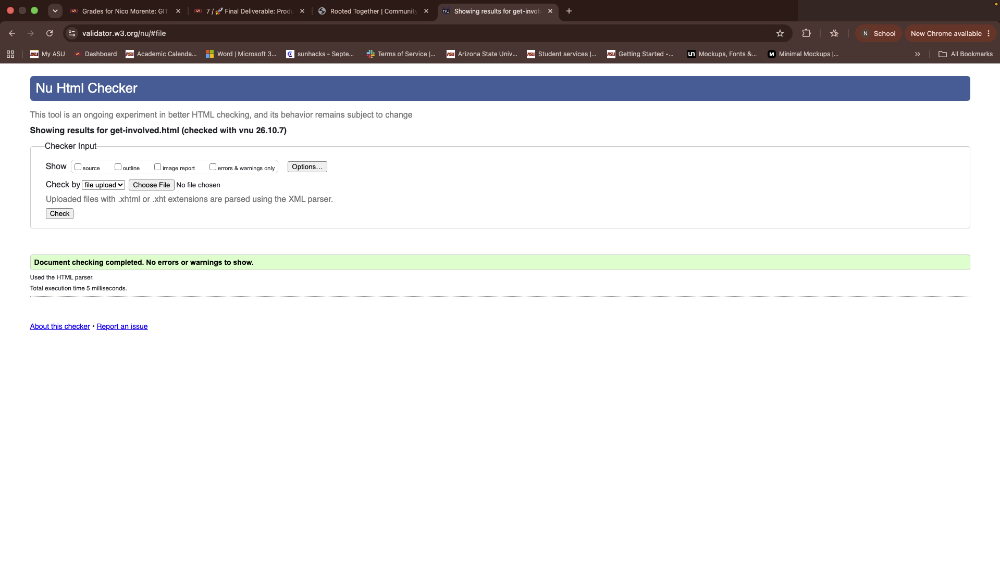
     - resources.html - No errors or warnings. 
   - Notes: Each screenshot is a validator result showing "Document checking completed. No errors or warnings to show."

 CSS validation
   - Method: W3C CSS Validator (https://jigsaw.w3.org/css-validator/)
   - Summary: css/styles.css validated with no errors.
   - Evidence: [Screenshots/cssW3Css.png](Screenshots/cssW3Css.png)
   - Notes: Validator reports "Congratulations! No Error Found." (CSS level 3 + SVG).

2. Broken-link checks
   - Method: linkcheckers such as `lychee`/`linkinator` or online tools.
   - Example (node linkinator): npx linkinator "./index.html" --recursive
   - Status: Manual verification performed for external links referenced on the Resources page — all verified reachable on 2026-10-09. The checked external links:
     - https://www.almanac.com/gardening/planting-calendar/AZ/Mesa
     - https://www.mesaaz.gov/Environment-Sustainability/Water-Conservation/Water-Adjustments-for-Plant-Growth
     - https://www.countryliving.com/gardening/a43043/composting/?utm_source=google&utm_medium=cpc&utm_campaign=mgu_ga_clv_d_bm_prog_org_us_a43043&gad_source=1&gad_campaignid=19268868227&gbraid=0AAAAACq-IrvMpmjLasxFGxtknzfbSZP03&gclid=CjwKCAjwnvTUBhBoEiwAZNDxZyYYymawfT4nTUQ1py8KPsWz48M3QX3rVmHdMFE6mH9S5CjPvy8QuRoC0KEQAvD_BwE
   - Contact form submit: Fixed — the contact form now uses `mailto:rootedtogetherr@gmail.com` so submissions open the visitor's email client and send to rootedtogetherr@gmail.com instead of leading to a broken/error page. Note: mailto-based submissions depend on a configured email client; for reliable collection consider a server-side form or third-party form service.

3. Responsive regression checks
   - Method: Manual and automated screenshots captured at the specific viewport widths used for verification.
   - Viewports captured (screenshots attached):
     - Mobile S - 320px width: 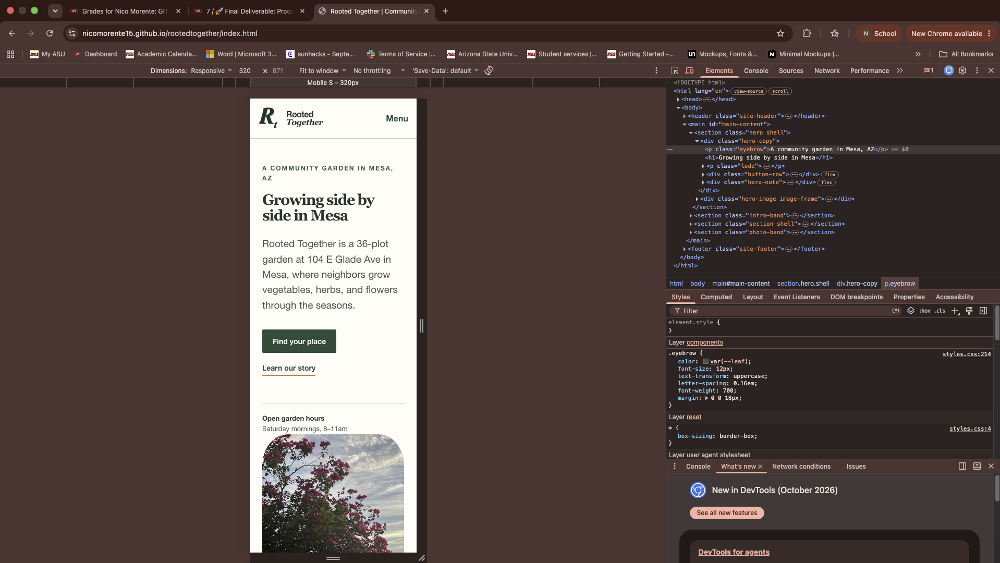
     - Mobile M - 375px width: 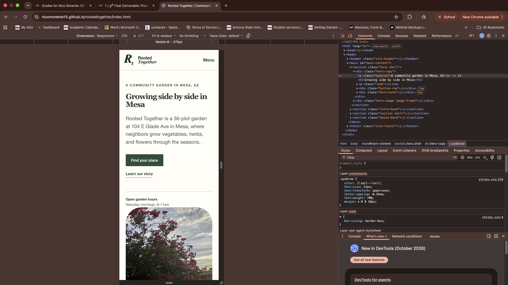
     - Tablet - 768px width: 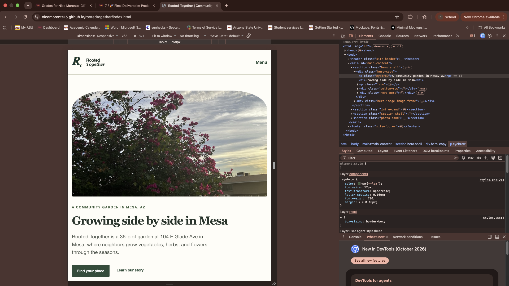
     - Laptop - 1024px width: 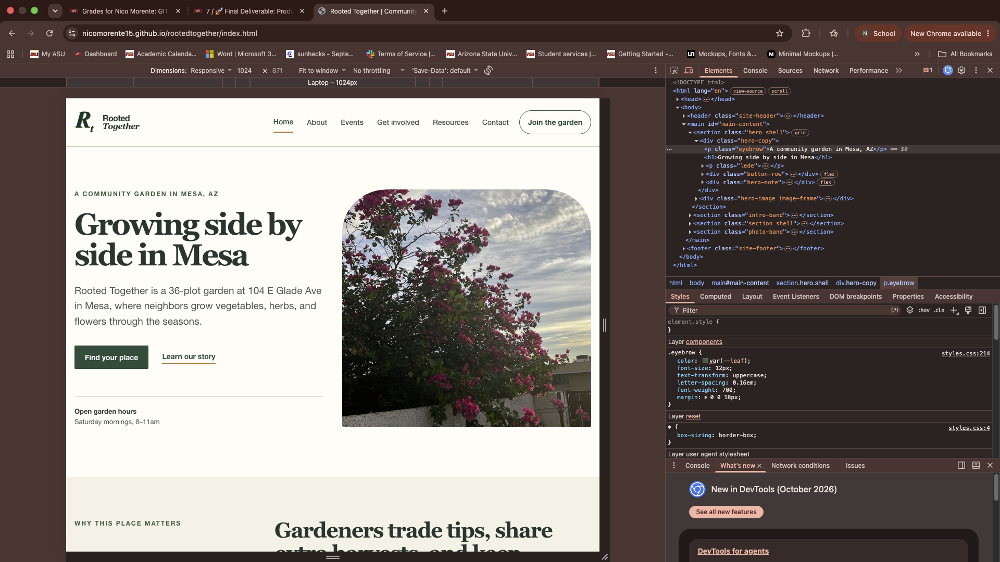
     - Desktop - 1440px width: 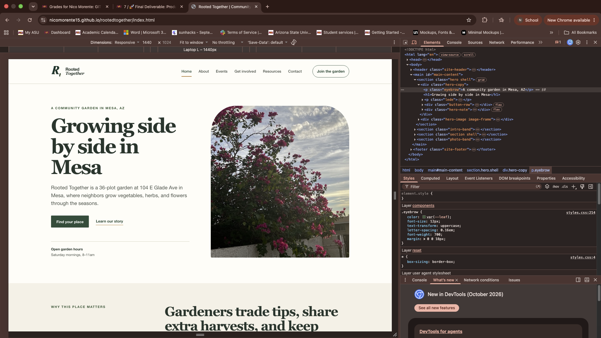
   - Example tooling: Puppeteer/Lighthouse screenshot scripts or browser devtools snapshots.
   - Status: Visual checks performed for index.html. Screenshots above show the site at each viewport.

4. Accessibility spot checks
   - Tools used: aXe DevTools (browser extension), Lighthouse Accessibility audit, and manual keyboard navigation and screen reader spot checks.

   - Example commands (run locally against the live preview):
     - For quick local checks, open the site in Chrome and run the aXe DevTools extension or run Lighthouse from DevTools.

   - Pages and interactive evidence captured (screenshots attached):
     - index.html - aXe DevTools scan: 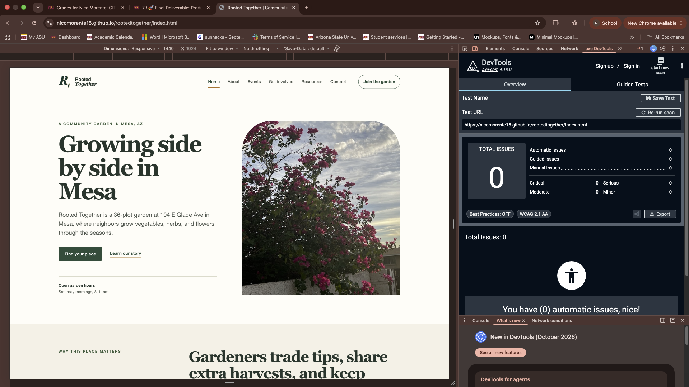
     - about.html - aXe DevTools scan: 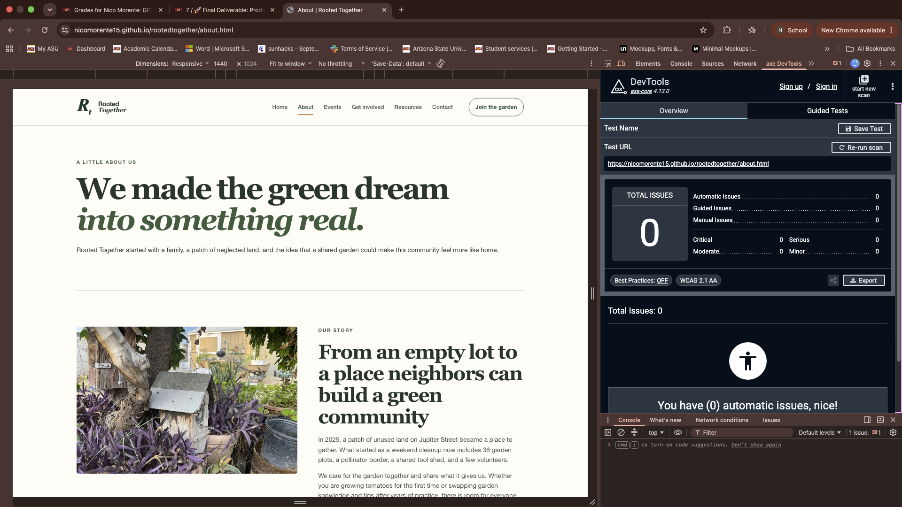
     - Keyboard navigation (Tab key) focus indicator evidence: 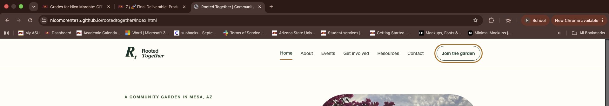
     - Focus visibility on interactive elements (hover/focus ring evidence): 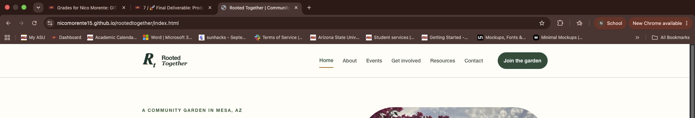

   - Findings and remediation:
     - aXe DevTools results: No accessibility violations were found on the tested pages. Both index.html and about.html passed the aXe DevTools scans (see attached screenshots).
     - Keyboard and focus evidence: Manual keyboard navigation (Tab) shows a visible focus indicator on interactive controls (see focusKeyboardEvidence.png). Hover and focus styles are visible and provide clear focus boundaries (see focusHoverEvidence.png).
     - Summary: No remediation was required following the aXe scans or manual focus checks. The site demonstrates keyboard-focus visibility and interactive focus styling on the tested pages.
     - Next steps: run pa11y and Lighthouse for automated site-wide checks and add their reports to /release/ if you want full-site automated evidence.

5. Performance diagnostic
   - Tool: Lighthouse (Chrome) and PageSpeed Insights

   - Method: Ran Lighthouse inside Chrome DevTools against the live site pages and captured the results.

   - Results (Lighthouse DevTools):
     - index.html - Performance: 98, Accessibility: 100, Best Practices: 100, SEO: 100. Screenshot: 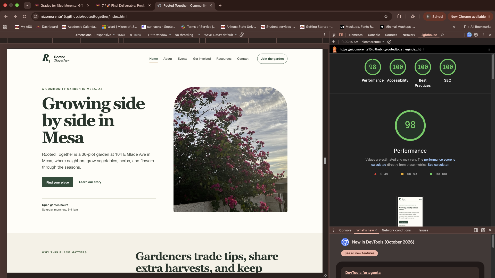
     - about.html - Performance: 98, Accessibility: 100, Best Practices: 100, SEO: 100. Screenshot: 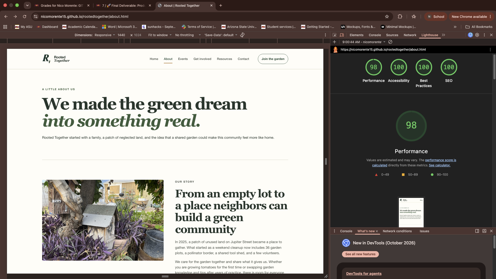

   - Key metrics to capture: First Contentful Paint (FCP), Largest Contentful Paint (LCP), Cumulative Layout Shift (CLS), Total Blocking Time (TBT), Speed Index - Lighthouse report contains the full metric breakdown.

   - Observations: These pages achieve excellent Lighthouse scores while preserving large hero imagery for visual impact. The tradeoff is longer full-page load time on constrained networks or older devices - the large hero images are the primary contributor to slower load times when the network is limited.

   - Optimizations already applied: responsive images via srcset/sizes, CSS consolidation and media-query optimizations, and general asset sizing.

6. Compatibility notes
   - Supported environments: modern evergreen browsers (Chrome, Edge, Firefox, Safari).

   - Graceful degradation: Layout remains readable in older browsers, no scripts required for basic navigation.

   - Cross-browser evidence: Verified visual rendering in Safari — see screenshot: 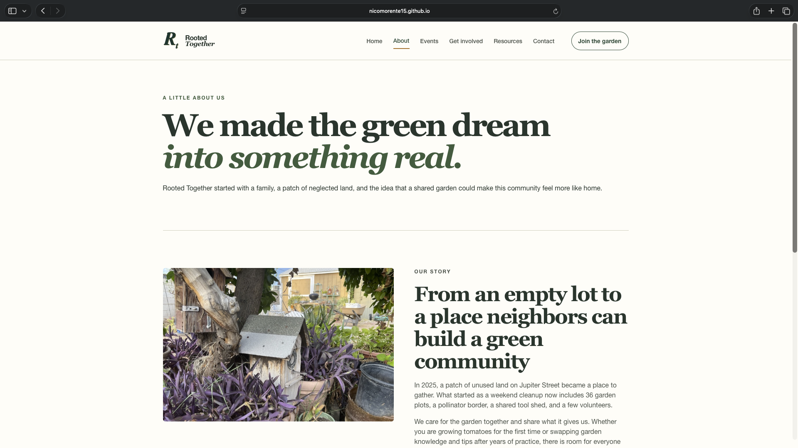

   - Known limitations: Minor spacing differences in older Safari versions, system fonts fallback considered in CSS.

7. Known limitations
   - No automated end-to-end tests provided - manual regression was used for the release.
   - Some low-impact Lighthouse performance opportunities remain

## 7. Technical defense
- I built Rooted Together, a community garden website for a local gardening group in Mesa, Arizona. The website provides information about the garden, upcoming events, gardening resources, and ways for people to get involved. It includes pages like Home, About, Events, Get Involved, Resources, and Contact to help visitors easily find what they are looking for.

Why it fits the audience/task:
  - The website is designed for local residents, beginner gardeners, and anyone interested in gardening or being part of their community. I wanted to keep the design clean, simple, and easy to navigate so visitors can find information without feeling overwhelmed.
  - I also made the website responsive so it can be viewed on different devices, including phones, tablets, and computers. 
  - Overall, Rooted Together meets the project's goals by giving the community garden an online presence where people can learn more, find events, and discover ways to participate.

What was tested:
  - HTML validation to ensure semantic correctness, manual responsive regression checks across common viewport sizes, accessibility spot checks (aXe/Lighthouse and keyboard navigation), and Lighthouse performance audits.

What was fixed after testing on mobile viewports:
  - Added explicit label elements and ARIA where necessary for form controls.
  - Replaced decorative alt text with empty alt attributes and provided descriptive alt on informative images.
  - Responsive stacking: enforced single-column stacking for split/hero/photo sections at narrow breakpoints so images appear above their related copy rather than side-by-side. This prevents overlap and improves legibility on phones (tested at 320, 375, 425 px).

- Image presentation: reserved vertical space for key images using responsive min-height (clamp with vh units) and set img to fill its frame (height:100%, width:100%, object-fit:cover). This keeps images visible and large on small screens instead of being shrunk by adjacent text.

- Contact form: forced the contact section to stack on small viewports and made the form full-width below contact details so fields are not clipped or horizontally scrolled.

- Horizontal-scroll fixes: added small-screen safety rules (overflow-x: hidden on container, max-width:100% for children, box-sizing adjustments) to eliminate horizontal scrolling at narrow widths.

- Typography tuning: reduced heading sizes and adjusted spacing at the smallest breakpoints to avoid the text compressing images or creating cramped layouts.

- Verification: manual responsive regression checks performed in DevTools at 320/375/425/768 px and visual confirmation that image-first stacking and form stacking behave across those sizes.

Remaining limitations:
  - Further image optimization (next-gen formats like AVIF) and automated tests (end-to-end) are planned.
  - Minor cross-browser visual differences documented in compatibility notes.

# AI Disclosure
- I used Ai to help me organize my documents and troubleshoot if im missing anything or if any of my files have errors that needs fixing. Preparing it for the final submission.
